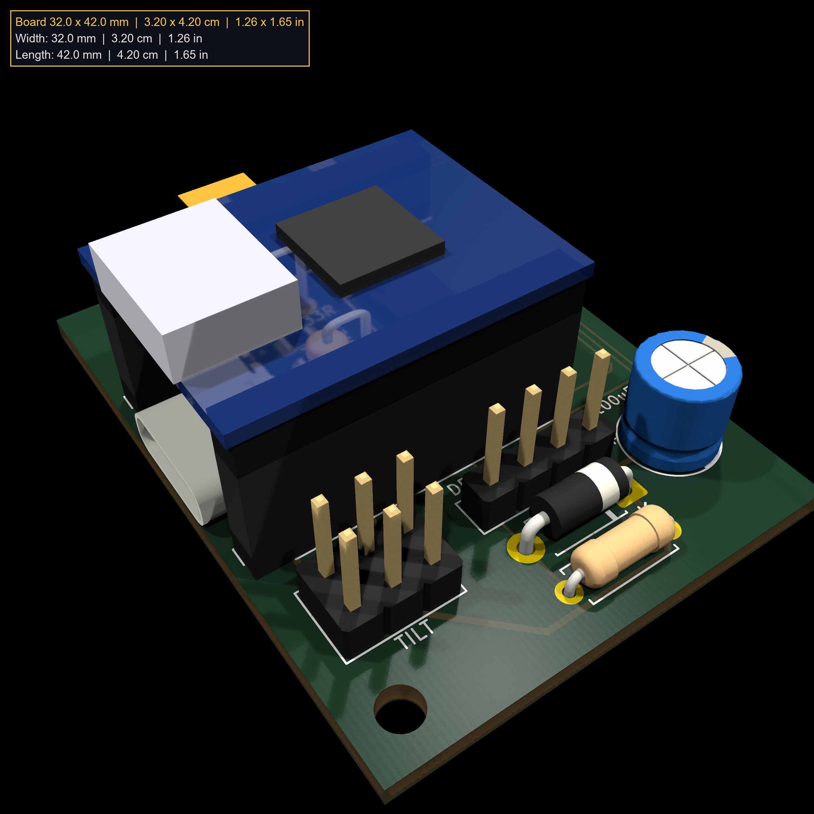
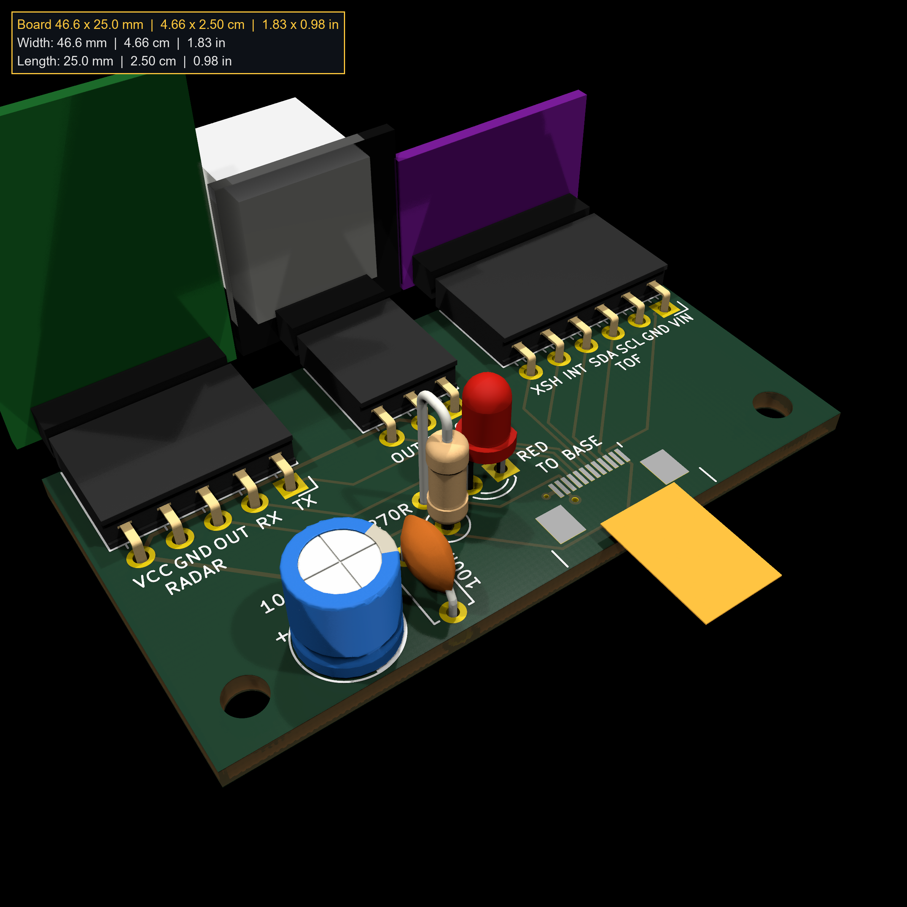
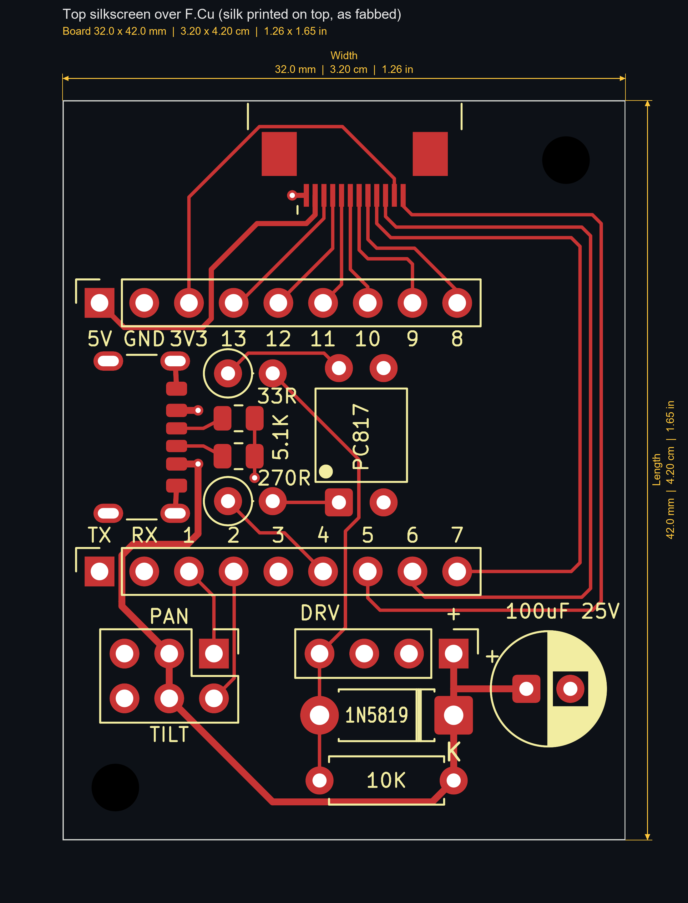
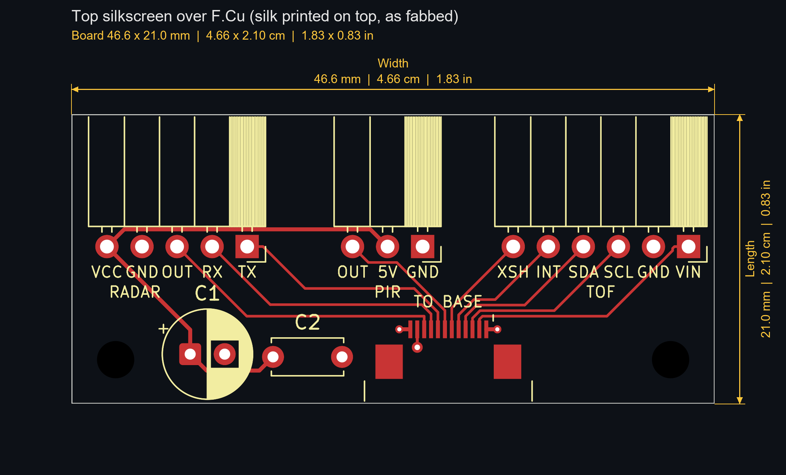

# Presence PCBs (atopile + KiCad), rev 2.1

Two boards joined by a 12-pin 0.5 mm FFC:

- **Base** (32.0 x 42.0 mm, module `Main`, build `default`): fixed on the
  pan-tilt base. ESP32-S3 SuperMini, the two SG90 servo plugs, a second USB-C
  (power only) for the servos, and a PC-case piezo beeper driven through a
  PC817.
- **Sensor head** (46.6 x 25.0 mm, module `Head`, build `head`): rides on
  the two servos. HLK LD2410C-P radar, SR602 PIR and VL53L1X ToF on
  right-angle sockets at the north edge, all facing north, and a red
  indicator LED behind the PIR that the firmware drives.

Only the light FFC moves with the head, so the servos never pull on a USB
cable. [`main.ato`](main.ato) is the single-file atopile project and the
source of truth for both netlists. Every part is defined locally with
explicit pins; all footprints are stock KiCad except the FFC connector and
the lying C1 (`footprints/PresenceRadar.pretty`, the lying C1 is unused
since rev 2.0). The boards are `layouts/default/default.kicad_pcb` (base) and
`layouts/head/head.kicad_pcb`, built, placed and routed by the scripts in
[`../Scripts/`](../Scripts/Scripts.md).





## Build

```bash
python Scripts/build_board.py base
python Scripts/build_board.py head
```

Each runs `ato build` and the whole chain for one board from a blank board:
netlist sync, layout, pours, routing, chamfers, DRC, renders (add
`--gerbers` for the fab package). `PCB_BOARD=base|head` picks the board
for the single scripts. `ato build` alone needs `PYTHONIOENCODING=utf-8`
(a Windows-console crash in atopile's `designator-map` step); in `ato.yaml`
the version key is `ato-version` (hyphenated).

## Revisions

- 1.0 (2026-11-02): 44 x 45 mm, SuperMini upright with USB-C at the south
  edge, power parts in an east strip. Gerbers built, not ordered.
- 1.1 (2026-11-02): 38.5 x 33.5 mm. SuperMini turned sideways; boost, C2
  and JP1 under it; C1 lying flat; pin labels moved to the bottom.
- 1.2 (2026-11-02): ToF socket moved into the north-west corner (both
  sensors now at the edges), north-west mounting hole moved between the
  sensors, sensor sockets keep their stock silk (a line per pin, pin-1
  hatch) cut at the board edge, pin labels on both sides.
- 1.3 (2026-11-03): 46.6 x 36.5 mm. SR602 PIR added between the two
  sensors, to veto radar motion with no warm body behind it (a fan beside
  the chair). Board now on a rear USB 3.2 Gen 1 port.
- 2.0 (2026-11-03): new outline family, split into a base and a sensor head on a two-servo
  pan-tilt, joined by a 12-pin 0.5 mm FFC. Base adds the servo plugs, a
  6-pin USB-C for the servo 5V (under the SuperMini's own USB-C, both
  cables leaving the west edge) and a piezo beeper. Boost and JP1
  dropped (a boost can go inline in the radar's supply later if the 5V
  pin sags). Pin map redone so the FFC fans straight into the SuperMini
  rows.
- 2.1 (2026-11-03): red indicator LED (D1, 3 mm, two holes) and its 270R
  (R1) on the head right behind the PIR, driven by GPIO5 over FFC base pin
  12 / head pin 1 (was the second GND). Head 46.6 x 25.0 mm (was 21.0) to
  fit it. D1 on the base is now a 1N5819 Schottky (was 1N4007, same DO-41
  holes). Every part's value printed on the top silkscreen.

## Board-to-board FFC

Cable: 12-pin, 0.5 mm pitch, 101 mm (a PS4 controller power-switch ribbon),
about 0.5 A per conductor. Connectors (J3 on the base, J4 on the head):
12-pin 0.5 mm flip-lock, bottom contact, surface mount. The footprint is
drawn from the store's 20-pin drawing scaled to 12 pins (pads 0.30 x 1.3
mm, mounting tabs 2.0 x 2.5 mm), so check it against the real part before
ordering. The two tabs carry no net; each end GND pad has a via to the
B.Cu pour beside it.

A same-side (type A) cable between the two bottom-contact connectors maps
base pin k to head pin 13 - k. The base cable leaves north, the head cable
leaves south; lay the cable flat between them without a twist or a crease.

| Base pin | Head pin | Net | Base pin | Head pin | Net |
|---|---|---|---|---|---|
| 1 | 12 | `gnd` | 7 | 6 | `tof_xshut` |
| 2 | 11 | `v5` | 8 | 5 | `tof_int` |
| 3 | 10 | `radar_out` | 9 | 4 | `tof_sda` |
| 4 | 9 | `radar_rx` | 10 | 3 | `tof_scl` |
| 5 | 8 | `radar_tx` | 11 | 2 | `v3v3` |
| 6 | 7 | `pir_out` | 12 | 1 | `led` |

The order follows the sensors west to east on the head (radar, PIR, ToF),
so both boards route on F.Cu. The two supplies sit on pins 2 and 11. Since
rev 2.1 only base pin 1 is GND; base pin 12 carries the LED. A cable of the
other type (k to k) swaps 5V and 3V3 and grounds the head only through
GPIO5, so it is no longer harmless. Before plugging in the sensors, check
with a meter: base J3 pin 2 (or the SuperMini 5V pin) must beep to the
head's radar VCC pin, and base pin 1 (GND) to the head's GND.

## Base board

- 32.0 x 42.0 mm, 1.6 mm, 2 layers. Everything through-hole except the FFC
  connector, the USB-C's six signal pads and the two 0805 CC pull-downs.
  DRC 0/0.
- SuperMini on J1 (north row, side A: 5V GND 3V3 13..8) and J2 (south row,
  side B: TX RX 1..7), rows 15.24 mm apart, **USB-C pointing west**, chip
  and antenna end east. Face up with the USB-C to the right, the 5V row is
  the near row (user-checked 2026-11-02). The last 4.8 mm at the antenna
  end is a copper keepout on both layers.
- North edge: FFC J3, cable leaving north. Its pins 3-8 fan straight down
  into GPIO13..8. The I2C pair (pins 9, 10) runs east above GPIO8, down
  the east edge (clear of the module's pins, for soldering) and back west
  under the south row to GPIO7/6; the LED line (pin 12) runs the same way
  just outside it to GPIO5.
  5V runs under the north row and up between the 3V3 and GPIO13 pins; 3V3
  runs under the connector body to pin 11.
- Under the SuperMini, all under 11 mm (the module's underside):
  - J5, the servo-power USB-C, mouth flush with the west edge right under
    the SuperMini's own USB-C (the receptacle is about 3.2 mm tall, the
    SuperMini's port sits about 12 mm up), so both cables leave the same
    edge and their plugs stack.
  - R4 and R5 (5.1k, 0805) right behind J5's CC pads, to GND.
  - The beeper: 33R (R2), 270R (R1) and the PC817 (U1) standing upright
    (pins 1-2 south, 3-4 north). Stand the resistors upright and press
    them down.
  - J5's two VBUS pads meet over a short B.Cu bridge behind its pads; the
    servo 5V leaves the module area between the TX and RX pins (0.4 mm
    track, the widest that fits between two socket pins).
- South strip: the two servo plugs on a 2x3 header (J4, pan row north, tilt
  row south, signal pins at the east end), the speaker header (J6), the
  1N5819 (D1) and the 10k (R3) lying flat as rungs across J6's pins 1 and 4
  (both 7.62 mm pitch), and C1 on the servo 5V.
- Routing: all F.Cu except J5's VBUS bridge; B.Cu is the GND pour. The
  tight spots are pre-drawn and locked by `layout_base.py` (the I2C pair,
  ToF INT, PIR and XSHUT fan-out, 5V, J5's CC, GND and VBUS stubs),
  because Freerouting boxed tracks in or necked them to 0.15 mm. Net
  classes: Power (`v5`) 0.3 mm, so it fits between 2.54 mm pads and onto
  the FFC's 0.3 mm pads; Servo (`servo_5v`) 0.4 mm; the rest 0.2 mm.
- Mounting holes (M2.5): north-east corner and south-west corner.
- Silkscreen: SuperMini pin labels on both sides, servo rows (TILT, PAN),
  speaker + and DRV. Every part's value (270R, 33R, 5.1K, PC817, 1N5819,
  10K, 100uF 25V) is printed on top instead of its reference, inside the
  body outline where there is one (PC817, 1N5819, 10K), next to it
  otherwise; the parts under the module repeat it on the bottom. The
  PC817 outline has no notch: like the PC Controller board, a dot marks
  the pin-1 corner, matching the moulded dot on the part.



## Sensor head

- 46.6 x 25.0 mm, 1.6 mm, 2 layers. DRC 0/0.
- North edge, west to east: radar (J1), PIR (J3), ToF (J2), on right-angle
  sockets whose openings sit 1 mm past the edge. Each module stands at 90
  degrees to the board and faces north. The three modules side by side set
  the board width.
- South edge: FFC J4, cable leaving south toward the base. Every signal
  fans straight up to its socket pin; the radar's 5V reaches the PIR along
  the north side of the radar pins, and the FFC's 5V pin reaches it over
  one short B.Cu hop.
- Silkscreen: sensor pin labels on both sides; each part's value (RED,
  270R, 100uF 25V, 100nF) next to it instead of its reference.
- Right behind the PIR: the red LED D1 (anode west, cathode to the GND
  pour) and its 270R R1 standing west of it. The LED line leaves FFC pin 1
  (east end), runs south under the connector body and comes up to R1.
- South-west: C1 (100 uF) and C2 (100 nF, pads north-south) on the
  radar's 5V. Mounting holes in both south corners.



## Parts

| Part | Board | Mount | Pin order |
|---|---|---|---|
| ESP32-S3 SuperMini | Base | 2x 1x9 female, vertical, rows 15.24 mm (0.6 in) apart, measured | Side A, USB-C end first: 5V GND 3V3 13 12 11 10 9 8. Side B: TX RX 1 2 3 4 5 6 7 |
| FFC connector x2 | Both | 12-pin 0.5 mm flip-lock, bottom contact, SMD | Pin 1 west on the base, east on the head |
| SG90 servos x2 | Base | J4, 2x3 male; one plug per row | S + - (orange, red, brown); signal pins at the west end |
| Servo 5V in (J5) | Base | 6-pin power-only USB-C receptacle ("Type-C 6P", 4 through-hole shell legs), stock GCT USB4125 footprint: check the legs against the real part | VBUS x2, GND x2, CC1, CC2; shell legs to GND |
| R4, R5 | Base | 5.1k 0805, behind J5 | CC1, CC2 pull-downs to GND. Without them a USB-C source (C-to-C cable) keeps VBUS off; an A-to-C cable gives 5V either way. Two 10k in parallel (5k) also work |
| PC-case piezo speaker | Base | J6, 1x4 male, motherboard SPEAKER layout | 1 = +5V (east), 4 = drive (west); 2, 3 unused |
| PC817 (U1) | Base | DIP-4 | 1 anode, 2 cathode, 3 emitter, 4 collector |
| R1 270R, R2 33R | Base | standing, 2.54 mm | |
| R3 10k, D1 1N5819 | Base | lying, 7.62 mm | D1 cathode east (to +5V), band = cathode. Schottky 40 V 1 A; a 1N4007 also fits |
| C1 (base) | Base | 100 uF / 25 V, 6.3 x 11 mm, standing | Servo 5V bulk, square pad = + |
| HLK LD2410C-P | Head | 1x5 female, right-angle | TX RX OUT GND VCC (Hi-Link LD2410C manual, table 1) |
| SR602 mini PIR (13.5 mm round board, 10 mm lens) | Head | 1x3 female, right-angle | Front view: - + OUT, so facing north OUT is west; pads GND 5V OUT, east to west. 3.7-12 V (listing; photo says 4.5-20 V); OUT 3.3 V digital, hold 1-18 s |
| VL53L1X breakout (GY-style, silkscreen "VL53L0/1XV2") | Head | 1x6 female, right-angle | VIN GND SCL SDA GPIO1 XSHUT, from the store listing |
| C1 (head) | Head | 100 uF / 25 V, 6.3 x 11 mm, standing. Chosen 2026-11-03: Linh kiện NtShop "Tụ hóa 25V" pack, 100uF/25V x20 | Radar 5V bulk, square pad = + |
| C2 (head) | Head | 100 nF ceramic disc, marked "104", 50 V, 5 mm pitch. Chosen 2026-11-03: "Combo 10 Tụ Gốm 104 100nF 50V" | Radar 5V, high frequency |
| D1 (head) | Head | Red LED, 3 or 5 mm, 2.54 mm leads, standing | Pad 1 (square) = cathode, flat side, short lead |
| R1 (head) | Head | 270R, standing, 2.54 mm | GPIO5 side south; (3.3 - 1.9) / 270 = about 5 mA |

The LED's 270R is the head's only resistor: the ToF breakout carries its
own I2C and XSHUT pull-ups, and the radar's UART and OUT are 3.3 V
push-pull. Check the ToF
pin order against the silkscreen on the real part before soldering.

The FFC connectors, J5's six pads and R4/R5 are the only surface-mount
parts. The FFC is 0.5 mm pitch: solder it with flux and a fine tip (drag,
then wick bridges), or have the fab place those parts. Solder J5 and R4/R5
before the SuperMini's sockets.

The fit models in the 3D renders are approximate outlines drawn by the
layout scripts, not measured parts.

## Pin map

| GPIO | Net | Use |
|---|---|---|
| 1 | `servo_pan` | Pan servo, 50 Hz LEDC, 500-2400 us |
| 2 | `servo_tilt` | Tilt servo |
| 4 | `beep` | PC817 LED through 270R; a 2-4 kHz square wave = tone |
| 5 | `led` | Head red LED, high = on (about 5 mA) |
| 6 | `tof_scl` | I2C SCL |
| 7 | `tof_sda` | I2C SDA |
| 8 | `tof_int` | ToF GPIO1, data-ready interrupt (open drain) |
| 9 | `tof_xshut` | ToF XSHUT, low = sensor off |
| 10 | `pir_out` | PIR OUT, high = warm body moved (3.3 V push-pull) |
| 11 | `radar_tx` | MCU RX from radar TX (UART1, 256000 8N1) |
| 12 | `radar_rx` | MCU TX to radar RX |
| 13 | `radar_out` | Radar OUT, high = presence |

Kept free: GPIO3 (strap), GPIO43/44 (UART0 boot log), GPIO48 (onboard
WS2812 and red LED). No spare GPIO left on the headers.

## Power

Two USB cables, both on rear panel ports, grounds shared:

- SuperMini USB-C, on a USB 3.2 Gen 1 port (900 mA; the SuperMini is a
  USB 2.0 device and uses that port's USB 2.0 lines). Its 5V and 3V3 pins
  are outputs: 5V feeds the radar and the PIR, 3V3 the ToF, both over the
  FFC.
- Servo USB-C (J5, second USB, power only): net `servo_5v` feeds both
  servos and the beeper, with C1 on the base. It never touches `v5`, so
  neither port can push current into the other, and servo and beep
  current stays off the sensors' supply. An SG90 draws up to about 650 mA
  stalled, so moving both at once can pass a port's 900 mA: move one servo
  at a time.

No diode on 5V: with one source per rail there is nothing to backfeed. A
Schottky in series would put the radar under Hi-Link's 5 V minimum.

The head's C1 sits on the SuperMini's VBUS, over the USB limit of 10 uF at
attach, so plugging in draws a short inrush spike. Rear panel ports are
current-limited and handle it. If the port ever browns out on plug-in,
lower C1 to 47 uF or add a soft-start; a diode does not fix inrush.

## Beeper

GPIO4 -> R1 270R -> PC817 LED (about 8 mA); the PC817's transistor pulls
the speaker's drive pin to GND through R2 33R, with the speaker's other pin
on `servo_5v`. The PC817's 50 mA output limit sets the beep current. R3 10k
across the speaker lets the piezo discharge between pulses; D1 clamps the
kick if a magnetic buzzer is ever plugged in instead.
