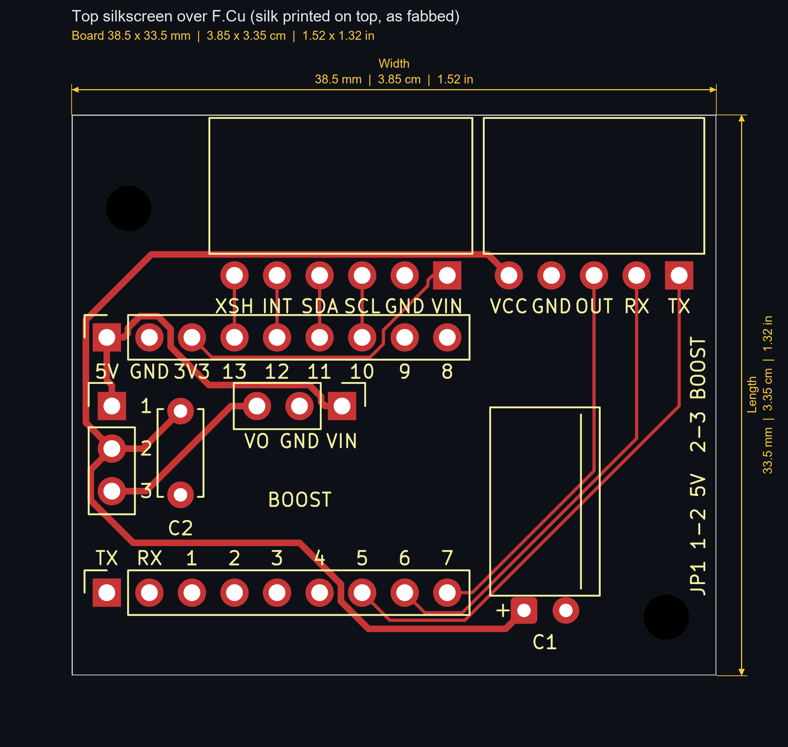
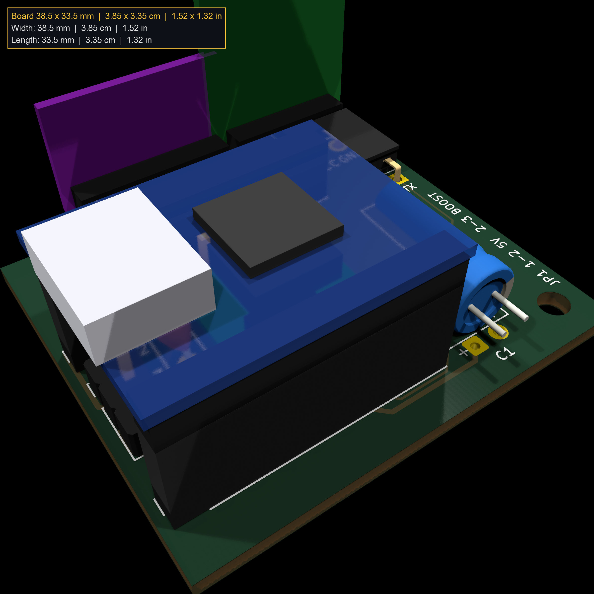
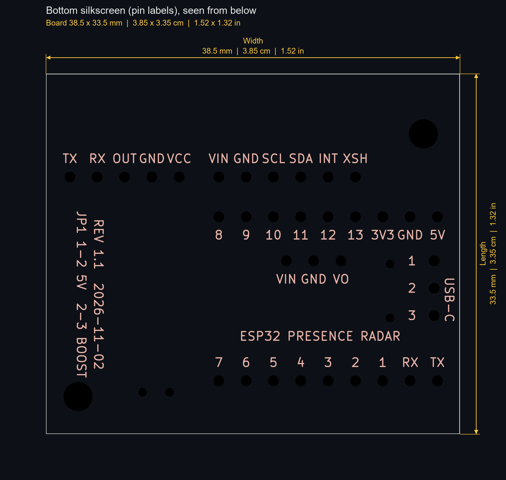

# Presence PCB (atopile + KiCad), rev 1.1

[`main.ato`](main.ato) is the single-file atopile project and the source of
truth for the netlist. Every part is defined locally with explicit pins; all
footprints are stock KiCad except C1's (`footprints/PresenceRadar.pretty`).
The KiCad board is `layouts/default/default.kicad_pcb`, built, placed and
routed by the scripts in [`../Scripts/`](../Scripts/Scripts.md), the same
chain as the ESP32 PC Controller carrier.





## Build

```bash
cd pcb
PYTHONIOENCODING=utf-8 ato build
```

`PYTHONIOENCODING=utf-8` works around a Windows-console crash in atopile's
`designator-map` step. `ato build` only writes `build/default.net`; the rest
of the chain (blank board, netlist sync, layout, pours, routing, DRC,
renders, Gerbers) is in [`../Scripts/Scripts.md`](../Scripts/Scripts.md). In
`ato.yaml` the version key is `ato-version` (hyphenated).

## Revisions

- 1.0 (2026-11-02): 44 x 45 mm, SuperMini upright with USB-C at the south
  edge, power parts in an east strip. Gerbers built, not ordered.
- 1.1 (2026-11-02): 38.5 x 33.5 mm. SuperMini turned sideways; boost, C2
  and JP1 under it; C1 lying flat; pin labels moved to the bottom.

## Board

- 38.5 x 33.5 mm, 1.6 mm, 2 layers, every part through-hole. DRC 0/0.
- North edge: ToF (J4, north-west) and radar (J3, north-east) on
  right-angle sockets whose openings sit 1 mm past the edge. Each module
  stands at 90 degrees to the board and faces north, away from it, so the
  board's north edge points at the chair.
- SuperMini on J1 (north row, side A: 5V GND 3V3 13..8) and J2 (south row,
  side B: TX RX 1..7), rows 15.24 mm apart, **USB-C pointing west**, chip
  and antenna end east. Face up with the USB-C to the right, the 5V row is
  the near row (user-checked 2026-11-02). With the USB-C pointing left
  instead, that row sits next to the sensors and GPIO13..10 line up under
  the ToF's XSHUT..SCL pins. The other way round, every ToF track would
  cross.
- Under the SuperMini, between its rows: JP1 at the USB-C end, then C2,
  then the boost (PS1) soldered on a 1x3 male header (module about 7.5 mm
  tall; the SuperMini's underside sits 11 mm up on its sockets). The last
  4.8 mm at the antenna end is a copper keepout on both layers. Changing
  JP1 means unplugging the SuperMini; it is a set-once choice at bring-up.
- East strip: C1 lying flat (leads bent 90 degrees, body pointing north),
  the radar supply and signal tracks, one mounting hole. The two sensor
  sockets fix the board width at 38.5 mm, so this strip costs no area. C1
  can't also go under the module: the boost (11 mm) and a lying 6.3 x 11 mm
  C1 (12.3 mm with its leads) don't fit in the 17 mm between the USB-C end
  and the antenna zone.
- Routing: everything on F.Cu; B.Cu is an unbroken GND pour. The Power
  class (`v5`, `radar_5v`, `boost_out`) is 0.4 mm so it fits between 2.54 mm
  header pads; `v3v3` feeds only the ToF and is 0.2 mm, running behind the
  ToF socket pins. Short B.Cu jumpers are allowed if a later change needs
  them.
- Mounting holes (M2.5): north-west corner beside the ToF, south-east corner.
- Silkscreen: both sides carry one label per pad. The top ones read while
  assembling; the bottom ones stay readable once the modules cover the top.
  The top also outlines each right-angle socket body (the part on the
  board, cut at the edge), JP1's pin numbers and setting, C1, C2 and the
  boost. The bottom adds the title, revision and a USB-C marker.



## Parts

| Part | Mount | Pin order |
|---|---|---|
| ESP32-S3 SuperMini | 2x 1x9 female, vertical, rows 15.24 mm (0.6 in) apart, measured | Side A, USB-C end first: 5V GND 3V3 13 12 11 10 9 8. Side B: TX RX 1 2 3 4 5 6 7 |
| HLK LD2410C-P | 1x5 female, right-angle | TX RX OUT GND VCC (Hi-Link LD2410C manual, table 1) |
| VL53L1X breakout (GY-style, silkscreen "VL53L0/1XV2") | 1x6 female, right-angle | VIN GND SCL SDA GPIO1 XSHUT, from the store listing |
| 0.9-5V to 5V boost (10.4 x 11 mm, SS14, 150 kHz) | Soldered on a 1x3 male header, face up, pins on its north edge, VIN east | V1 GND Vo (store photo) |
| JP1 | 1x3 pin header + jumper cap, under the SuperMini | 1 = SuperMini 5V, 2 = radar 5V, 3 = boost out |
| C1 | 100 uF / 16 V electrolytic, 6.3 x 11 mm, leads bent 90 degrees, lying flat | Radar 5V bulk, square pad = + |
| C2 | 100 nF ceramic disc, under the SuperMini | Radar 5V, high frequency |

No resistors. The ToF breakout carries its own I2C and XSHUT pull-ups, the
radar's UART and OUT are 3.3 V push-pull straight into the ESP32, and no
GPIO drives a load. Check the ToF pin order against the silkscreen on the
real part, and meter the boost's GND pin, before soldering.

The fit models in the 3D renders (the SuperMini at its real height, the
boost, the two sensors standing in their sockets) are approximate outlines
drawn by `layout_board.py`, not measured parts.

## Pin map

| GPIO | Net | Use |
|---|---|---|
| 5 | `radar_tx` | MCU RX from radar TX (UART1, 256000 8N1) |
| 6 | `radar_rx` | MCU TX to radar RX |
| 7 | `radar_out` | Radar OUT, high = presence |
| 10 | `tof_scl` | I2C SCL |
| 11 | `tof_sda` | I2C SDA |
| 12 | `tof_int` | ToF GPIO1, data-ready interrupt (open drain) |
| 13 | `tof_xshut` | ToF XSHUT, low = sensor off |

Kept free: GPIO3 (strap), GPIO43/44 (UART0 boot log), GPIO48 (onboard
WS2812 and red LED). Spare: GPIO1, 2, 4, 8, 9.

## Power

The board's only supply is the SuperMini's own USB-C, plugged into a rear
panel USB 2.0 port. The SuperMini's 5V and 3V3 pins are outputs: 5V feeds
the radar and C1/C2, 3V3 feeds the ToF.

Jumper jp1 picks the radar's supply (net `radar_5v`). With the cap on 1-2
the radar runs from the SuperMini 5V pin directly. With the cap on 2-3 it
runs from the boost, which is fed from that same pin. The boost output only
reaches jp1 pin 3, so the boost can stay plugged in either way without
fighting the USB rail. The boost helps only when the 5V pin sits under
5.0 V (a diode on the SuperMini, cable drop): it lifts it back to 5.0 V. At
5.0 V or more in, its output is the input minus the SS14 drop, about 4.7 V,
which is worse than direct. It also adds 150 kHz switching ripple, which C1
and C2 filter. Measure the 5V pin at bring-up and pick the jumper position
from that.

No diode on 5V. With one source there is nothing for C1 to backfeed: when
the port turns off, C1 (1.25 mJ at 5 V) drains into the board's own load
within milliseconds. A Schottky in series would drop 0.3 to 0.45 V and put
the radar under Hi-Link's 5 V minimum.

C1 is over the USB 2.0 limit of 10 uF on VBUS at attach, so plugging in
draws a short inrush spike. Rear panel ports are current-limited and handle
it. If the port ever browns out on plug-in, lower C1 to 47 uF or add a
soft-start; a diode does not fix inrush.
